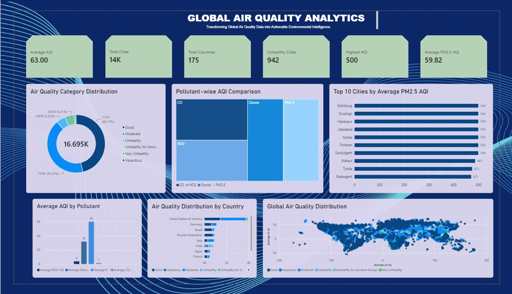

# 🌍 Global Air Quality Analytics

### Transforming Global Air Quality Data into Actionable Environmental Intelligence

## 📌 Project Overview

Global Air Quality Analytics is a data analytics project developed using **Microsoft Power BI** as part of **SWYNEX Task 3 – Data Analytics**.

The project focuses on analysing global air quality data to understand AQI levels, identify cities with poor air quality, examine country-wise distributions, and compare different pollutant-related AQI indices.

## 🎯 Project Objectives

- Analyse global Air Quality Index (AQI) levels.
- Identify cities with the highest PM2.5 AQI.
- Understand the distribution of air quality categories.
- Compare AQI values across different pollutants.
- Explore country-wise air quality distribution.
- Visualise geographical patterns using latitude and longitude coordinates.

## 📊 Dashboard Preview

## 📈 Key Performance Indicators (KPIs)

The dashboard includes six key performance indicators:

- **Average AQI** – Overall average air quality index.
- **Total Cities** – Number of distinct cities in the dataset.
- **Total Countries** – Number of countries represented.
- **Highest AQI** – Maximum recorded AQI value.
- **Unhealthy Cities** – Number of cities classified as unhealthy or worse.
- **Average PM2.5 AQI** – Average PM2.5-related AQI value.

## 📉 Visualizations

The dashboard includes six interactive visualizations:

1. Air Quality Category Distribution – Donut Chart
2. Pollutant-wise AQI Comparison – Treemap
3. Top 10 Cities by Average PM2.5 AQI – Bar Chart
4. Average AQI by Pollutant – Column Chart
5. Air Quality Distribution by Country – Stacked Bar Chart
6. Global Air Quality Distribution – Coordinate Scatter Chart

## 🛠️ Tools & Technologies

- Microsoft Power BI
- Power Query
- DAX (Data Analysis Expressions)
- Data Visualization
- Data Cleaning and Transformation

## 🧮 DAX Implementation

DAX was used to create calculated measures for:

- Average AQI
- Total Cities
- Total Countries
- Highest AQI
- Unhealthy Cities
- Average PM2.5 AQI
- Average CO AQI
- Average Ozone AQI
- Average NO2 AQI

A calculated table named **Pollutant Analysis** was also created using DAX to support the pollutant comparison treemap.

## 📂 Dataset

**Dataset Name:** AQI and Lat Long of Countries

**Source:** [Hugging Face – World Air Quality Dataset](https://huggingface.co/datasets/jason1966/adityaramachandran27_world-air-quality-index-by-city-and-coordinates)

The dataset contains city-level air quality information, pollutant-related AQI values, country details, and geographical coordinates.

## 🔍 Project Limitations

- The dataset does not contain a date or year column, so historical trend analysis is not included.
- The geographical scatter chart represents coordinate-based data points rather than a dedicated interactive map.
- Pollutant AQI values represent AQI sub-indices, not raw pollutant concentrations.

## 📁 Repository Contents

- `Global_Air_Quality_Analytics.pbix` – Power BI project file.
- `Dashboard_Screenshot.png` – Dashboard preview.
- `README.md` – Project documentation.

## 👩‍💻 Project Details

| Category | Details |
|---|---|
| Organization | SWYNEX |
| Task | Task 3 |
| Domain | Data Analytics |
| Tool | Microsoft Power BI |
| Project | Global Air Quality Analytics |
